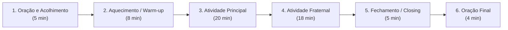

# 🌱 Contexto Institucional do DEE-AEOF e Perfil Vivo do Grupo *Bona Volo*

## 1. Identidade Institucional e Marco Histórico

- **Instituição Sede**: Associação Espírita Obreiros da Fraternidade (AEOF)
- **Localização**: Cruz das Almas — Bahia (Recôncavo Baiano)
- **Vínculos Federativos**: Registrado e vinculado à **FEEB** (Federação Espírita do Estado da Bahia) e à **FEB** (Federação Espírita Brasileira).
- **Marco Pioneiro**: **Primeiro Departamento de Esperanto e Espiritismo (DEE) da história do Estado da Bahia**, assumindo vocação de núcleo-piloto, memória histórica e inspiração fraterna para o movimento espírita baiano.
- **Integração com o EAD da FEB**: O DEE mantém informações estruturadas sobre as turmas online/híbridas/assíncronas da Diretoria da FEB (EAD), servindo como ponte e canal de divulgação para interessados que não possam comparecer ao horário presencial.

---

## 2. Infraestrutura e Logística dos Encontros

- **Modalidade**: Presencial, semanal.
- **Horário e Duração**: Às **16h40**, com duração de **60 minutos (1 hora)**.
- **Espaço Físico**: Sala da Evangelização Infantojuvenil da AEOF (ambiente acolhedor e preparado para dinâmicas visuais e pedagógicas) + possibilidade de uso de **espaços abertos e em contato com a natureza** em Cruz das Almas.
- **Recursos Disponíveis**: Notebook, projetor, papel, canetas, lápis de cor/materiais de papelaria.

---

## 3. Mapa Humano e Agógico do Grupo *Bona Volo* (6 Integrantes)

> **Princípio Norteador Decidido Democraticamente pelo Grupo**:  
> **A confraternização e o fortalecimento dos vínculos afetivos são a prioridade número 1**, atuando como o catalisador emocional e espiritual (Psicologia Positiva / PERMA) para o aprendizado do Esperanto.

| Integrante | Idade / Perfil | Nível CEFR | Papel no Ecossistema e Estratégia Agógica Personalizada |
| :--- | :--- | :--- | :--- |
| **Rafael** | 36 anos — Diretor do DEE e Coordenador do *Bona Volo* | **A1–A2** | **Facilitador-Par (*Kunlernanto-Gvidanto*)**: Como não há um professor tradicional expositivo, atua como mediador do círculo de coaprendizagem, conduzindo o ritmo dos 60 minutos e fazendo a ponte entre os materiais-base (Prof. Cícero Gabriel / *Kompleta Naturmetodo*) e a vivência em grupo. |
| **Raíza** | 35 anos — Psicóloga e Evangelizadora Infantojuvenil (esposa de Rafael) | **A0–A1** | **Co-mediadora Psicopedagógica e Afetiva**: Sua experiência em Psicologia e Evangelização Infantil é um tesouro para co-conduzir os momentos de acolhimento, as dinâmicas fraternas e o engajamento lúdico de Miguel e Maria. |
| **Mariza** | ~40–50 anos — Professora Universitária (Genética) | **A0–A1** | **Aprendiz Analítica e Criativa (Andragogia)**: Pela formação em Genética, tem alta afinidade com sistemas lógicos, padrões e recombinação (a estrutura de raízes + prefixos + sufixos do Esperanto funciona como um "código genético" linguístico fascinante para ela). |
| **Miguel** | 11 anos — Estudante (irmão de Maria, filho de Nilda) | **A0–A1** | **Aprendiz Infantojuvenil (Pedagogia *Tween-Friendly*)**: Na faixa dos 11 anos, engaja-se muito com desafios, gamificação, enigmas, cultura pop/curiosidades, movimento físico e construção coletiva com sua irmã e os adultos. |
| **Maria** | 10 anos — Estudante (irmã de Miguel, filha de Nilda) | **A0–A1** | **Aprendiz Infantojuvenil (Pedagogia *Kids/Tween-Friendly*)**: Na faixa dos 10 anos, responde muito bem a narrativas visuais, músicas, jogos de cartas/tabuleiro, dramatizações leves (*Kompleta Naturmetodo* adaptado em cena) e artes. |
| **Nilda** | Adulta — Mãe de Miguel e Maria | **Observadora / Participante Afetiva** | **Membro Pleno de Fraternidade (*Amika Partoprenantino*)**: Declara-se não aprendiz formal, mas participa da socialização e de atividades pontuais. **Regra de Ouro**: Nunca expô-la a cobrança ou teste linguístico; incluí-la sempre como peça-chave nas dinâmicas fraternas, acolhimento, reflexões e jogos em que possa contribuir em português ou com palavras-chave simples que absorver naturalmente (*Bonan tagon, Dankon, Paco, Amiko*). |

---

## 4. Arquitetura Inteligente dos 60 Minutos Semanais

Como o encontro tem exatamente **60 minutos** (16h40 às 17h40), o Design Educacional divide a sessão em **6 blocos rítmicos** que equilibram espiritualidade, ludicidade, aprendizagem multigeracional e fraternidade:

1. **Oração e Acolhimento (*Preĝo kaj Bonveno* — ~5 min | 16h40–16h45)**:
   - Recepção afetuosa (incluindo Nilda e as crianças), breve pensamento luminoso (Evangelho / *Interna Ideo*) e prece inicial simples (podendo introduzir gradualmente uma frase curta em Esperanto com tradução, ex.: *"Dio benu nian renkontiĝon"*).
2. **Aquecimento (*Warm-up / Varmigo* — ~8 min | 16h45–16h53)**:
   - Quebra-gelo energético, musical ou visual que ativa a atenção de Miguel e Maria e relaxa os adultos (ex.: jogo rápido de gestos/TPR, pergunta afetiva da semana, canção curta ou desafio de adivinhação de palavras transparentes).
3. **Atividade Principal (*Ĉefa Aktivado* — ~20 min | 16h53–17h13)**:
   - Baseada no cronograma, no canal do **Prof. Cícero Gabriel** e no ***Kompleta Naturmetodo***, porém **transposta para formato interativo e *Kids-Friendly***:
     - Em vez de leitura passiva ou vídeo longo, usamos **micro-vídeo/trecho visual (3–5 min)** + **encenação viva / jogo de papéis / missão em duplas intergeracionais** (ex.: Miguel e Maria atuam como detetives da cena do *Naturmetodo*, enquanto Rafael, Raíza e Mariza interagem nos diálogos).
4. **Atividade Fraternal (*Frata Aktivado* — ~18 min | 17h13–17h31)**:
   - O coração do grupo *Bona Volo*: dinâmica de psicologia positiva (PERMA), roda de histórias de vida, jogo cooperativo onde **Nilda participa de igual para igual**, preparação de pequenas ações fraternas, música ou vivência sensorial.
5. **Fechamento (*Closing / Fermo* — ~5 min | 17h31–17h36)**:
   - "Qual foi a palavra ou o sentimento favorito de hoje?" (*Kiun vorton aŭ senton vi plej ŝatis hodiaŭ?*), síntese visual no caderno/quadro e pílula leve opcional para a semana.
6. **Oração de Encerramento (*Fina Preĝo* — ~4 min | 17h36–17h40)**:
   - Gratidão coletiva, vibrações de paz para a AEOF, para Cruz das Almas e para a humanidade, encerrando pontualmente às 17h40.
