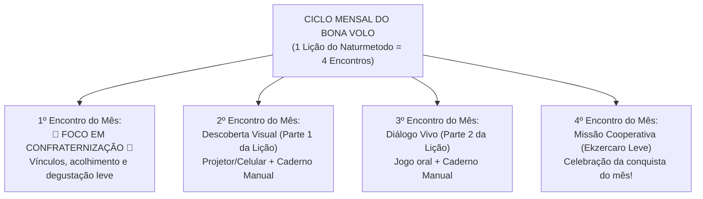

# 🏛️ Plano Diretor do DEE (Anual, Semestral e Trimestral)
**Associação Espírita Obreiros da Fraternidade (AEOF) — Cruz das Almas, BA**  
*Alinhado à Diretriz Administrativa DEE-01/2025, à FEEB e à FEB*

---

## 1. Visão Geral e Ajuste Estratégico de Ritmo (18 Meses para o 1º Ciclo)

O **Departamento de Esperanto e Espiritismo (DEE)** da AEOF — o **primeiro DEE da história da Bahia** — adota um ritmo sustentável, acolhedor e de **baixa carga cognitiva**, perfeitamente alinhado à meta oficial da **Diretriz Administrativa DEE-01/2025** (*"Médio Prazo [6–18 meses]: Conclusão do primeiro ciclo gramatical"*):

- **Ritmo Mensal (1 Lição do *Naturmetodo* por Mês = 4 Encontros por Lição)**:
  - **Encontro 1 de cada mês**: **Encontro Especial de Confraternização** (foco prioritário no estreitamento de laços fraternos, música, acolhimento e psicologia positiva, com apenas uma degustação levíssima do tema do mês).
  - **Encontros 2, 3 e 4 de cada mês**: Desdobramento suave da Lição do mês em pequenas doses (microlearning), sem pressa e sem sobrecarga para crianças (Miguel e Maria) ou adultos.
- **Progressão sem Impressora (100% Projetor/WhatsApp + Papel/Caderno Manual)**:
  - Todas as atividades são compartilhadas virtualmente (via WhatsApp e Projetor da Sala da Evangelização) para serem **respondidas e desenhadas manualmente** em folhas de papel ou no caderno de cada integrante.

---

## 2. Planejamento Anual, Semestral e Trimestral (Ritmo Realista e Sustentável)

Com o ritmo de **1 Lição por Mês (3 Lições por Trimestre | 6 Lições por Semestre | 12 Lições no Ano 1)**, o grupo conclui com segurança a base comunicativa no primeiro ano e finaliza todas as **20 Lições do *Naturmetodo*** no **3º Trimestre do Ano 2 (18 meses)** — cumprindo com precisão o cronograma do Regulamento Interno!

### 🗓️ 1º SEMESTRE (Meses 1 a 6) — CONSOLIDAÇÃO FRATERNA E FUNDAÇÃO (Lições 1 a 6)
*(Corresponde às Metas de Curto Prazo [0–6 meses] da Diretriz DEE-01/2025)*

#### 🔹 1º Trimestre (Meses 1, 2 e 3) — *Raízes de Boa Vontade ("Radikoj de Bona Volo")*
- **Ritmo dos Encontros Presenciais (12 encontros)**:
  - **Mês 1 (Encontros 1 a 4)**: **Lição 1** (*O Mundo e a Nossa Roda Familiar*) — iniciando no **Encontro 1 com foco total na Confraternização de Recomeço**.
  - **Mês 2 (Encontros 5 a 8)**: **Lição 2** (*A Família Hansen, Cores e Animais*) — iniciando no Encontro 5 com a Confraternização Mensal das Cores da Amizade.
  - **Mês 3 (Encontros 9 a 12)**: **Lição 3** (*Laços de Família, Posse e o Acusativo Básico*) — iniciando no Encontro 9 com a Confraternização Mensal da Família (homenagem especial à Nilda e aos laços familiares) ou piquenique ao ar livre.
- **Gestão e Divulgação no 1º Trimestre**:
  - Organização do **Mural Informativo "Esperanto e Fraternidade"** com os materiais físicos já doados pela FEEB (bandeira, marca-páginas e panfletos) + cartazes escritos à mão de forma artística pelo próprio grupo (Miguel, Maria e adultos!) ou divulgados digitalmente no WhatsApp da AEOF, incluindo o guia das turmas **EAD da FEB**.
  - Sistematização dos **3 primeiros Relatórios Mensais** para a Diretoria Executiva da AEOF.

#### 🔹 2º Trimestre (Meses 4, 5 e 6) — *Laços de Amizade ("Ligiloj de Amikeco")*
- **Ritmo dos Encontros Presenciais (12 encontros)**:
  - **Mês 4 (Encontros 13 a 16)**: **Lição 4** (*A Casa e o Jardim — Nia Ĝardeno*), iniciando com o 1º encontro do mês focado em confraternização.
  - **Mês 5 (Encontros 17 a 20)**: **Lição 5** (*Visitando Parentes e Amigos — Viagem e Afeto*), iniciando com o 1º encontro do mês focado em confraternização.
  - **Mês 6 (Encontros 21 a 24)**: **Lição 6** (*O Calendário da Vida, Meses e Aniversários*), iniciando com a Confraternização Mensal de Aniversários do Grupo (*Feliĉan Naskiĝtagon!*).
- **Gestão e Divulgação no 2º Trimestre**:
  - Catalogação simples do acervo de livros e relíquias doado pela FEEB.
  - Entrega do **1º Balanço Semestral** à Diretoria da AEOF e observação participativa para futura Secretaria Adjunta.

---

### 🗓️ 2º SEMESTRE (Meses 7 a 12) — FLORESCIMENTO E IRRADIAÇÃO (Lições 7 a 12)
*(Primeira metade das Metas de Médio Prazo [6–18 meses] da Diretriz DEE-01/2025)*

#### 🔹 3º Trimestre (Meses 7, 8 e 9) — *Luz, Corpo e Natureza ("Lumo kaj Naturo")*
- **Ritmo dos Encontros Presenciais (12 encontros)**:
  - **Mês 7 (Encontros 25 a 28)**: **Lição 7** (*O Relógio, os Números e as Estações da Vida*) — 1º encontro do mês focado em confraternização (celebrando também o mês de aniversário do Esperanto, julho!).
  - **Mês 8 (Encontros 29 a 32)**: **Lição 8** (*O Corpo Humano e os 5 Sentidos*) — 1º encontro do mês com vivência fraternal sensorial.
  - **Mês 9 (Encontros 33 a 36)**: **Lição 9** (*Ferramentas `-il-`, Pássaros e Enigmas*) — 1º encontro do mês em contato com a natureza em Cruz das Almas.
- **Gestão e Divulgação no 3º Trimestre**:
  - **Convite formal para a Secretaria Adjunta** (iniciando a transição da gestão unipessoal).
  - Realização de uma **Roda de Conversa / Palestra de Sensibilização** aberta ao público da AEOF e convidados não-espíritas.

#### 🔹 4º Trimestre (Meses 10, 11 e 12) — *Hospitalidade, Lugares e Celebração ("Gastamo kaj Festo")*
- **Ritmo dos Encontros Presenciais (12 encontros)**:
  - **Mês 10 (Encontros 37 a 40)**: **Lição 10** (*A Arte de Receber Bem: Chá, Café, Limonada e Gratidão*) — 1º encontro do mês com o **Chá/Lanche Fraterno Real** do *Bona Volo*!
  - **Mês 11 (Encontros 41 a 44)**: **Lição 11** (*Lugares `-ej-`, Animais e Cartas de Amizade*) — 1º encontro do mês focado em confraternização.
  - **Mês 12 (Encontros 45 a 48)**: **Lição 12** (*Nossa Casa, Rotina e a Pergunta: "Ĉu vi estas feliĉa?"*) — 1º encontro do mês celebrando o encerramento anual e o ***Zamenhofa Tago***.
- **Gestão e Governança no 4º Trimestre**:
  - Revisão Anual do Regulamento DEE-01/2025 e inclusão da proposta orçamentária conforme Nota Explicativa.
  - *(Nota: As **Lições 13 a 20** completam-se nos 6 meses seguintes [Meses 13 a 18], fechando exatamente o ciclo de **18 meses** previsto nas Metas de Médio Prazo do Regulamento!)*
