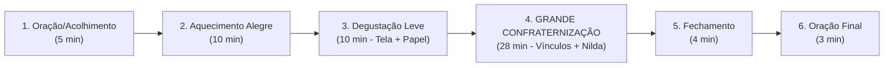
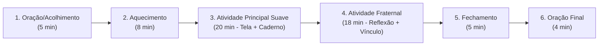

# 🎯 Guia Prático de Facilitação (60 Minutos) — Protocolo Sem Impressora & Ciclo de 4 Encontros
**Como conduzir o Grupo *Bona Volo* com baixa carga cognitiva, 1º encontro do mês focado em Confraternização e atividades 100% Tela + Papel Manual**

---

## 1. As 3 Diretrizes Operacionais do *Bona Volo*

1. **Ritmo de Baixa Carga Cognitiva (1 Lição = 1 Mês = 4 Encontros)**:
   - Nunca tentamos espremer uma lição inteira em 1 ou 2 encontros. Dividimos cada lição do *Kompleta Naturmetodo* em **4 semanas suaves**, garantindo que **Miguel (11), Maria (10), Mariza, Raíza, Nilda e você** saiam de cada encontro com sensação de leveza e dever cumprido.
2. **Regra do 1º Encontro de Cada Mês (*Renkontiĝo de Frateco*)**:
   - Todo **primeiro encontro do mês** dedica a maior parte do seu tempo (**28 a 30 minutos**) à **Confraternização e ao Estreitamento de Vínculos**, trazendo apenas uma degustação curtíssima (**10 minutos**) de palavras transparentes da nova lição.
3. **Protocolo Zero Impressora (*Tela Virtual + Resposta Manual no Papel*)**:
   - Não dependemos de impressora para nada!
   - **Onde o grupo vê a atividade**: Projetada na parede da Sala da Evangelização pelo seu notebook (usando o nosso arquivo interativo `.html` ou `.md`) **e/ou** enviada no grupo de WhatsApp do *Bona Volo* para abrir no celular.
   - **Onde o grupo responde**: Manualmente, usando **papel, caderno, canetas e lápis de cor** disponíveis na sala (escrevendo apenas os números das questões e as palavras-resposta, ou desenhando!).

---

## 2. Os Dois Modelos de Divisão dos 60 Minutos (16h40 às 17h40)

### 🌟 MODELO A: 1º Encontro de Cada Mês (Foco Prioritário em Confraternização)

- **16h40 – 16h45 (5 min)**: Oração e Acolhimento afetuoso.
- **16h45 – 16h55 (10 min)**: Aquecimento musical ou brincadeira de roda em grupo.
- **16h55 – 17h05 (10 min)**: **Degustação Leve da Lição do Mês** (apenas 6 a 8 palavras fáceis no projetor/celular + pequeno desenho manual na frente da folha de papel).
- **17h05 – 17h33 (28 min)**: **Grande Atividade Fraternal do Mês** (dinâmica de histórias de vida, psicologia positiva/PERMA, arte manual no verso da folha, música ou vivência ao ar livre, com participação central de Nilda, das crianças e dos adultos).
- **17h33 – 17h37 (4 min)**: Fechamento afetivo (*"Como meu coração sai hoje?"*).
- **17h37 – 17h40 (3 min)**: Oração de Encerramento.

---

### 🔍 MODELO B: Encontros 2, 3 e 4 do Mês (Estudo em Pequenas Doses + Fraternidade)

- **16h40 – 16h45 (5 min)**: Oração e Acolhimento.
- **16h45 – 16h53 (8 min)**: Aquecimento dinâmico (gestos, contagem com palmas ou jogo oral rápido).
- **16h53 – 17h13 (20 min)**: **Atividade Principal em Doses Pequenas**:
  - **Encontro 2 do mês**: Primeira metade da lição (4 a 5 palavras novas + 4 frases simples respondidas à mão no caderno olhando para o projetor).
  - **Encontro 3 do mês**: Segunda metade da lição (perguntas orais em dupla + passaporte escrito à mão no caderno).
  - **Encontro 4 do mês**: Missão cooperativa do *Ekzercaro* (projetado no telão e enviado no WhatsApp; as duplas anotam apenas os números e respostas no caderno e clicam na tela para conferir!).
- **17h13 – 17h31 (18 min)**: **Atividade Fraternal & Reflexão Evangélica** (conexão moral do vocabulário do dia com o Pentateuco + roda de partilha).
- **17h31 – 17h36 (5 min)**: Fechamento (palavra favorita do dia).
- **17h36 – 17h40 (4 min)**: Oração de Encerramento.
